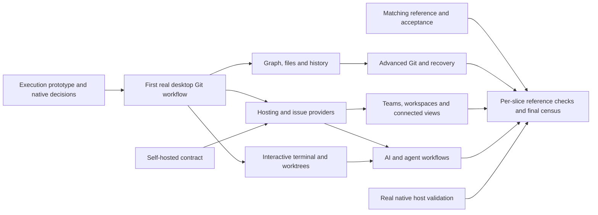

# Proposed implementation breakdown

Status: draft for review — 135 proposed work items; no implementation tickets have been published from this draft.

## Review requested

Review ticket size, real blocking edges and merge/split changes. Approval publishes the agreed tickets to the configured local tracker. It does not close unresolved architecture/reference decisions, approve a licensing model, or mark unknown behavior ready to implement.

## Start order

1. Work the existing execution-contract prototype with real disposable Git repositories. Establish native support/tooling and obtain matching reference access in parallel where independent.
2. Confirm the prototype contract and the native support choice; then start the first production slice: a running app that opens a repository and records its real commands.
3. Deliver diffs, staging/commit and partial changes as complete workflows. Provider and self-hosted work can begin when their own service decisions and prerequisites are settled.
4. Continue through the frontier, not through an artificial all-of-phase barrier. Feature ordering never reduces full parity scope.

## Decision gates

| Gate | Existing work | Meaning |
| --- | --- | --- |
| G4 | [Complete parity acceptance](../../.scratch/gitkraken-parity/issues/04-parity-acceptance.md) | Acceptance/verification contract remains open |
| G5 | [Execution and repository coordination contract](../../.scratch/gitkraken-parity/issues/05-execution-contract.md) | Implementation contract for dependent work remains open |
| G6 | [Equivalent self-hosted service and provider contract](../../.scratch/gitkraken-parity/issues/06-service-boundaries.md) | Implementation contract for dependent work remains open |
| G7 | [Matching reference build and feature access](../../.scratch/gitkraken-parity/issues/07-reference-access.md) | Matching-build access and reference evidence remains open |
| G8 | [Git distribution and native platform support](../../.scratch/gitkraken-parity/issues/08-native-support.md) | Implementation contract for dependent work remains open |

G5 and G8 gate production slices. G6 additionally gates connected service/provider/AI/agent work. G7 and G4 gate exact reference verification, with unresolved behavior also holding any slice that cannot yet be specified honestly. Approval of this breakdown does not resolve these gates.

## Milestones

| Group | Purpose | Work items |
| --- | --- | --- |
| A | First complete desktop Git workflows | 5 |
| B | Repository files, graph and navigation | 9 |
| C | History editing and conflicts | 10 |
| D | Remotes and extended Git | 18 |
| E | Terminals, recovery and desktop integration | 13 |
| F | Hosting providers, PRs and issue trackers | 23 |
| G | Self-hosted accounts, collaboration and connected views | 24 |
| H | AI and coding-agent workflows | 16 |
| I | Settings, activity and integration completion | 11 |
| J | Native delivery and platform validation | 4 |
| K | Reference census and final acceptance | 2 |

Milestones are navigation groups, not serial release gates. The graph below shows broad streams; individual ticket prerequisites are authoritative.

## Proposed tickets

1. **[Open a repository in a running desktop app](tickets/001-open-a-repository-in-a-running-desktop-app.md)** — **Type:** vertical-slice. **Blocked by:** no implementation tickets; decision gates G5, G8. **What it delivers:** Launch the native Tauri app, open a local repository, inspect real branch/status/history data and see the exact read commands and results in a collapsible action panel.

2. **[Inspect changed and historical files](tickets/002-inspect-changed-and-historical-files.md)** — **Type:** vertical-slice. **Blocked by:** 1: Open a repository in a running desktop app; decision gates G5, G8. **What it delivers:** Select a changed or historical file and inspect real hunk, inline and split diffs with change navigation.

3. **[Stage files and commit real changes](tickets/003-stage-files-and-commit-real-changes.md)** — **Type:** vertical-slice. **Blocked by:** 1: Open a repository in a running desktop app; 2: Inspect changed and historical files; decision gates G5, G8. **What it delivers:** Stage one or all changed files, write a message and create a real commit while watching the actual Git commands.

4. **[Stage, unstage and discard lines or hunks](tickets/004-stage-unstage-and-discard-lines-or-hunks.md)** — **Type:** vertical-slice. **Blocked by:** 2: Inspect changed and historical files; 3: Stage files and commit real changes; decision gates G5, G8. **What it delivers:** Choose complete files, individual lines or hunks to stage, unstage or discard, and inspect the resulting staged and unstaged diffs.

5. **[Ignore files and stop tracking explicitly](tickets/005-ignore-files-and-stop-tracking-explicitly.md)** — **Type:** vertical-slice. **Blocked by:** 3: Stage files and commit real changes; decision gates G5, G8. **What it delivers:** Use file actions to ignore a filename, extension or directory, or deliberately stop tracking an already tracked file.

6. **[Create, edit, save and delete repository files](tickets/006-create-edit-save-and-delete-repository-files.md)** — **Type:** vertical-slice. **Blocked by:** 2: Inspect changed and historical files; 3: Stage files and commit real changes; decision gates G5, G8. **What it delivers:** Create files and nested directories, browse/filter the tree, edit content, save or discard pending edits, and stage saved work including workflow YAML.

7. **[Inspect historical files and encoded documents](tickets/007-inspect-historical-files-and-encoded-documents.md)** — **Type:** vertical-slice. **Blocked by:** 6: Create, edit, save and delete repository files; decision gates G5, G8. **What it delivers:** Inspect historical content while editing the current file, choose supported encodings and preview Markdown without silently converting bytes.

8. **[Use commit templates and co-authors](tickets/008-use-commit-templates-and-co-authors.md)** — **Type:** vertical-slice. **Blocked by:** 3: Stage files and commit real changes; decision gates G5, G8. **What it delivers:** Configure and apply the correct repository/global commit template, edit message fields, add co-authors and resize the message editor.

9. **[Amend the latest commit](tickets/009-amend-the-latest-commit.md)** — **Type:** vertical-slice. **Blocked by:** 3: Stage files and commit real changes; decision gates G5, G8. **What it delivers:** Amend staged changes or the latest message, with explicit update/cancel behavior and refreshed history.

10. **[Navigate the commit graph](tickets/010-navigate-the-commit-graph.md)** — **Type:** vertical-slice. **Blocked by:** 1: Open a repository in a running desktop app; decision gates G5, G8. **What it delivers:** Inspect commit, merge, stash and WIP nodes, select details, highlight related history and customize/filter graph columns.

11. **[Work in multiple repository tabs](tickets/011-work-in-multiple-repository-tabs.md)** — **Type:** vertical-slice. **Blocked by:** 1: Open a repository in a running desktop app; decision gates G5, G8. **What it delivers:** Open, close, reorder and switch repositories through tabs, path tooltips, dropdowns and keyboard navigation.

12. **[Execute actions through menus and keyboard navigation](tickets/012-execute-actions-through-menus-and-keyboard-navigation.md)** — **Type:** vertical-slice. **Blocked by:** 3: Stage files and commit real changes; 10: Navigate the commit graph; 11: Work in multiple repository tabs; decision gates G5, G8. **What it delivers:** Search and execute context-appropriate actions through the command palette and matching menu/shortcut routes.

13. **[Create, check out, rename and delete branches](tickets/013-create-check-out-rename-and-delete-branches.md)** — **Type:** vertical-slice. **Blocked by:** 10: Navigate the commit graph; decision gates G5, G8. **What it delivers:** Manage branches from graph/sidebar actions, including ghost-branch checkout and multi-selection deletion.

14. **[Work in detached HEAD and preserve commits](tickets/014-work-in-detached-head-and-preserve-commits.md)** — **Type:** vertical-slice. **Blocked by:** 13: Create, check out, rename and delete branches; 3: Stage files and commit real changes; decision gates G5, G8. **What it delivers:** Check out a commit, see detached-HEAD status, create commits and preserve them on a new branch or return to a branch.

15. **[Merge branches through the graph](tickets/015-merge-branches-through-the-graph.md)** — **Type:** vertical-slice. **Blocked by:** 13: Create, check out, rename and delete branches; 3: Stage files and commit real changes; decision gates G5, G8. **What it delivers:** Merge using drag/drop or context actions, including the reference squash-merge preference and staged result.

16. **[Resolve a conflicted merge](tickets/016-resolve-a-conflicted-merge.md)** — **Type:** vertical-slice. **Blocked by:** 15: Merge branches through the graph; 2: Inspect changed and historical files; decision gates G5, G8. **What it delivers:** Inspect current/incoming/output panes, choose or edit resolutions, take one side, use an external tool and complete the merge.

17. **[Rebase a branch or selected range](tickets/017-rebase-a-branch-or-selected-range.md)** — **Type:** vertical-slice. **Blocked by:** 13: Create, check out, rename and delete branches; 16: Resolve a conflicted merge; decision gates G5, G8. **What it delivers:** Rebase a branch, selected range or branchless target and resolve or recover from a conflicted operation.

18. **[Edit an interactive rebase plan](tickets/018-edit-an-interactive-rebase-plan.md)** — **Type:** vertical-slice. **Blocked by:** 17: Rebase a branch or selected range; 8: Use commit templates and co-authors; decision gates G5, G8. **What it delivers:** Pick, reword, squash or drop supported commits through the application, reset the plan and complete the operation without an external editor.

19. **[Cherry-pick and edit a multi-commit selection](tickets/019-cherry-pick-and-edit-a-multi-commit-selection.md)** — **Type:** vertical-slice. **Blocked by:** 13: Create, check out, rename and delete branches; 16: Resolve a conflicted merge; 8: Use commit templates and co-authors; decision gates G5, G8. **What it delivers:** Cherry-pick from a commit or branch head and edit a multi-commit plan with ordering, reword, squash and drop actions.

20. **[Squash a consecutive history selection](tickets/020-squash-a-consecutive-history-selection.md)** — **Type:** vertical-slice. **Blocked by:** 10: Navigate the commit graph; 8: Use commit templates and co-authors; decision gates G5, G8. **What it delivers:** Select a valid linear range, edit the resulting message and create the squashed history.

21. **[Reset, revert and restore historical files](tickets/021-reset-revert-and-restore-historical-files.md)** — **Type:** vertical-slice. **Blocked by:** 10: Navigate the commit graph; 3: Stage files and commit real changes; decision gates G5, G8. **What it delivers:** Choose soft/mixed/hard reset, revert a commit, or restore selected historical files with truthful resulting state.

22. **[Create, inspect, apply, pop and delete stashes](tickets/022-create-inspect-apply-pop-and-delete-stashes.md)** — **Type:** vertical-slice. **Blocked by:** 3: Stage files and commit real changes; 10: Navigate the commit graph; decision gates G5, G8. **What it delivers:** Name and manage stashes through toolbar, graph, sidebar and commit-panel routes.

23. **[Stash or restore selected changes](tickets/023-stash-or-restore-selected-changes.md)** — **Type:** vertical-slice. **Blocked by:** 4: Stage, unstage and discard lines or hunks; 22: Create, inspect, apply, pop and delete stashes; decision gates G5, G8. **What it delivers:** Create a partial stash or restore selected files from an existing stash while preserving the intended remaining changes.

24. **[Pin, hide, solo and search visible history](tickets/024-pin-hide-solo-and-search-visible-history.md)** — **Type:** vertical-slice. **Blocked by:** 10: Navigate the commit graph; 13: Create, check out, rename and delete branches; 22: Create, inspect, apply, pop and delete stashes; decision gates G5, G8. **What it delivers:** Control reference/stash visibility through individual and bulk actions without mutating Git history.

25. **[Configure remotes and inspect their identity](tickets/025-configure-remotes-and-inspect-their-identity.md)** — **Type:** vertical-slice. **Blocked by:** 1: Open a repository in a running desktop app; decision gates G5, G8. **What it delivers:** Add, edit, remove and inspect remotes with provider identity and supported shallow-remote options.

26. **[Fetch remotes and show ahead/behind state](tickets/026-fetch-remotes-and-show-ahead-behind-state.md)** — **Type:** vertical-slice. **Blocked by:** 25: Configure remotes and inspect their identity; decision gates G5, G8. **What it delivers:** Fetch one or all remotes and configure periodic background fetching while seeing accurate status and history updates.

27. **[Complete remote authentication and input requests](tickets/027-complete-remote-authentication-and-input-requests.md)** — **Type:** vertical-slice. **Blocked by:** 26: Fetch remotes and show ahead/behind state; decision gates G5, G8. **What it delivers:** Complete helper/askpass/SSH/signing-related interaction requests for a remote operation without invisible prompts or credential output.

28. **[Push commits and handle divergence](tickets/028-push-commits-and-handle-divergence.md)** — **Type:** vertical-slice. **Blocked by:** 27: Complete remote authentication and input requests; 3: Stage files and commit real changes; 13: Create, check out, rename and delete branches; decision gates G5, G8. **What it delivers:** Push from toolbar, menus or drag/drop, create a missing upstream branch and expose the reference divergence choices.

29. **[Pull with the selected integration strategy](tickets/029-pull-with-the-selected-integration-strategy.md)** — **Type:** vertical-slice. **Blocked by:** 27: Complete remote authentication and input requests; 26: Fetch remotes and show ahead/behind state; 15: Merge branches through the graph; 17: Rebase a branch or selected range; decision gates G5, G8. **What it delivers:** Choose and remember fast-forward, merge-fallback, fast-forward-only or rebase pulling and set the upstream.

30. **[Clone and open repositories](tickets/030-clone-and-open-repositories.md)** — **Type:** vertical-slice. **Blocked by:** 27: Complete remote authentication and input requests; 1: Open a repository in a running desktop app; decision gates G5, G8. **What it delivers:** Clone by URL or a connected-provider selection, configure supported shallow options and open the result.

31. **[Clone and manage sparse checkout selection](tickets/031-clone-and-manage-sparse-checkout-selection.md)** — **Type:** vertical-slice. **Blocked by:** 30: Clone and open repositories; decision gates G5, G8. **What it delivers:** Choose sparse clone paths and get the reference behavior when the path selection is empty.

32. **[Initialize a repository with templates](tickets/032-initialize-a-repository-with-templates.md)** — **Type:** vertical-slice. **Blocked by:** 1: Open a repository in a running desktop app; decision gates G5, G8. **What it delivers:** Initialize at a chosen path with ignore/license options and open the resulting repository.

33. **[Organize repositories through the repository hub](tickets/033-organize-repositories-through-the-repository-hub.md)** — **Type:** vertical-slice. **Blocked by:** 11: Work in multiple repository tabs; 30: Clone and open repositories; 32: Initialize a repository with templates; decision gates G5, G8. **What it delivers:** Browse, locate, open, clone and initialize through repository management, with details/README, recent/favorite navigation and favorite shortcuts.

34. **[Create and manage local and remote tags](tickets/034-create-and-manage-local-and-remote-tags.md)** — **Type:** vertical-slice. **Blocked by:** 10: Navigate the commit graph; 13: Create, check out, rename and delete branches; 28: Push commits and handle divergence; decision gates G5, G8. **What it delivers:** Create lightweight/annotated tags, inspect annotations, navigate/filter/solo them and perform the observed push/move/rename/delete flows.

35. **[Create and manage linked worktrees](tickets/035-create-and-manage-linked-worktrees.md)** — **Type:** vertical-slice. **Blocked by:** 13: Create, check out, rename and delete branches; 11: Work in multiple repository tabs; 24: Pin, hide, solo and search visible history; decision gates G5, G8. **What it delivers:** Create, open, find, lock/unlock and remove worktrees with correct branch/folder/path display and inherited view settings.

36. **[Reconcile concurrent and interrupted repository operations](tickets/036-reconcile-concurrent-and-interrupted-repository-operations.md)** — **Type:** vertical-slice. **Blocked by:** 35: Create and manage linked worktrees; 3: Stage files and commit real changes; 27: Complete remote authentication and input requests; decision gates G5, G8. **What it delivers:** Run operations across worktrees, observe external changes and recover from lock conflicts or interrupted child processes with truthful state.

37. **[Add, update and navigate submodules](tickets/037-add-update-and-navigate-submodules.md)** — **Type:** vertical-slice. **Blocked by:** 30: Clone and open repositories; 28: Push commits and handle divergence; decision gates G5, G8. **What it delivers:** Add/initialize/update submodules, inspect their state, switch into them and commit updated pointers with the configured automatic-update policy.

38. **[Start and finish Gitflow work](tickets/038-start-and-finish-gitflow-work.md)** — **Type:** vertical-slice. **Blocked by:** 13: Create, check out, rename and delete branches; 15: Merge branches through the graph; 34: Create and manage local and remote tags; decision gates G5, G8. **What it delivers:** Configure Gitflow names/prefixes and start or finish feature, release and hotfix workflows through real multi-step Git operations.

39. **[Manage LFS files and transfers](tickets/039-manage-lfs-files-and-transfers.md)** — **Type:** vertical-slice. **Blocked by:** 30: Clone and open repositories; 28: Push commits and handle divergence; 37: Add, update and navigate submodules; decision gates G5, G8. **What it delivers:** Initialize LFS, track patterns, inspect pointer metadata and run supported transfer/prune actions from the interface.

40. **[Sign commits and tags with GPG](tickets/040-sign-commits-and-tags-with-gpg.md)** — **Type:** vertical-slice. **Blocked by:** 3: Stage files and commit real changes; 34: Create and manage local and remote tags; 27: Complete remote authentication and input requests; decision gates G5, G8. **What it delivers:** Select/generate a GPG key, configure the signing program and defaults, and inspect verification states on actual signed history.

41. **[Sign and verify with SSH keys](tickets/041-sign-and-verify-with-ssh-keys.md)** — **Type:** vertical-slice. **Blocked by:** 40: Sign commits and tags with GPG; decision gates G5, G8. **What it delivers:** Configure SSH signing and allowed signers, sign real changes and copy the public key for provider setup.

42. **[Configure and observe Git hooks](tickets/042-configure-and-observe-git-hooks.md)** — **Type:** vertical-slice. **Blocked by:** 3: Stage files and commit real changes; 15: Merge branches through the graph; 17: Rebase a branch or selected range; 19: Cherry-pick and edit a multi-commit selection; 28: Push commits and handle divergence; 27: Complete remote authentication and input requests; decision gates G5, G8. **What it delivers:** Configure hook locations, run normal hook-dependent operations, inspect hook output and bypass hooks for one commit when requested.

43. **[Use a real embedded interactive terminal](tickets/043-use-a-real-embedded-interactive-terminal.md)** — **Type:** vertical-slice. **Blocked by:** 1: Open a repository in a running desktop app; decision gates G5, G8. **What it delivers:** Open a repository-bound shell, type commands, resize or minimize it and terminate the chosen session.

44. **[Manage persistent per-worktree terminal tabs](tickets/044-manage-persistent-per-worktree-terminal-tabs.md)** — **Type:** vertical-slice. **Blocked by:** 43: Use a real embedded interactive terminal; 35: Create and manage linked worktrees; decision gates G5, G8. **What it delivers:** Open, select, close and reorder terminal tabs with the reference keyboard/focus/scroll/label behavior while processes continue across worktree changes.

45. **[Customize terminal input and completion](tickets/045-customize-terminal-input-and-completion.md)** — **Type:** vertical-slice. **Blocked by:** 43: Use a real embedded interactive terminal; decision gates G5, G8. **What it delivers:** Use command/flag completion, configure terminal typography/cursor behavior and insert dragged files or text as input.

46. **[Undo and redo supported local actions](tickets/046-undo-and-redo-supported-local-actions.md)** — **Type:** vertical-slice. **Blocked by:** 9: Amend the latest commit; 4: Stage, unstage and discard lines or hunks; 13: Create, check out, rename and delete branches; 21: Reset, revert and restore historical files; 25: Configure remotes and inspect their identity; decision gates G5, G8. **What it delivers:** Undo and redo the supported checkout/commit/discard/reference/reset actions, with contextual availability and truthful state.

47. **[Undo and redo history rewriting](tickets/047-undo-and-redo-history-rewriting.md)** — **Type:** vertical-slice. **Blocked by:** 46: Undo and redo supported local actions; 18: Edit an interactive rebase plan; 19: Cherry-pick and edit a multi-commit selection; 20: Squash a consecutive history selection; 14: Work in detached HEAD and preserve commits; decision gates G5, G8. **What it delivers:** Undo and redo the supported history-editing operations, including the reference detached-HEAD reset/rebase recovery behavior.

48. **[Search commits and navigate matches](tickets/048-search-commits-and-navigate-matches.md)** — **Type:** vertical-slice. **Blocked by:** 10: Navigate the commit graph; 12: Execute actions through menus and keyboard navigation; decision gates G5, G8. **What it delivers:** Search by message, SHA or author, navigate highlighted matches and understand the loaded-history limit.

49. **[Compare selections and inspect file history or blame](tickets/049-compare-selections-and-inspect-file-history-or-blame.md)** — **Type:** vertical-slice. **Blocked by:** 2: Inspect changed and historical files; 10: Navigate the commit graph; decision gates G5, G8. **What it delivers:** Compare commits or WIP, combine consecutive selections, inspect file history and blame, and explain unsupported selections.

50. **[Create and apply local patches](tickets/050-create-and-apply-local-patches.md)** — **Type:** vertical-slice. **Blocked by:** 49: Compare selections and inspect file history or blame; 4: Stage, unstage and discard lines or hunks; 12: Execute actions through menus and keyboard navigation; decision gates G5, G8. **What it delivers:** Create patches from supported selected files/commits and apply them through the palette.

51. **[Open repositories and references from external links](tickets/051-open-repositories-and-references-from-external-links.md)** — **Type:** vertical-slice. **Blocked by:** 33: Organize repositories through the repository hub; 13: Create, check out, rename and delete branches; 34: Create and manage local and remote tags; decision gates G5, G8. **What it delivers:** Open a repository through CLI/deep links, navigate to a reference, offer a prefilled clone and choose among multiple local copies.

52. **[Separate identities, preferences and tabs with profiles](tickets/052-separate-identities-preferences-and-tabs-with-profiles.md)** — **Type:** vertical-slice. **Blocked by:** 11: Work in multiple repository tabs; 3: Stage files and commit real changes; decision gates G5, G8. **What it delivers:** Create/switch profiles with isolated identities, settings, accounts and tab sets; update global Git identity only through the explicit option.

53. **[Use configured editors and external tools](tickets/053-use-configured-editors-and-external-tools.md)** — **Type:** vertical-slice. **Blocked by:** 6: Create, edit, save and delete repository files; 16: Resolve a conflicted merge; 43: Use a real embedded interactive terminal; decision gates G5, G8. **What it delivers:** Detect/select editors and diff/merge/terminal tools, run them for the selected repository context and expose custom commands.

54. **[Select themes and follow system appearance](tickets/054-select-themes-and-follow-system-appearance.md)** — **Type:** vertical-slice. **Blocked by:** 10: Navigate the commit graph; 2: Inspect changed and historical files; decision gates G5, G8, G4. **What it delivers:** Choose supported built-in/system themes and expose only the custom-theme behavior actually present in 12.6.1.

55. **[Inspect scoped activity and diagnostic output](tickets/055-inspect-scoped-activity-and-diagnostic-output.md)** — **Type:** vertical-slice. **Blocked by:** 1: Open a repository in a running desktop app; 42: Configure and observe Git hooks; decision gates G5, G8. **What it delivers:** Inspect application/repository activity with timestamps/durations, follow hook-output links, enable diagnostic detail and forget stored credentials.

56. **[Connect to internally trusted Git hosts](tickets/056-connect-to-internally-trusted-git-hosts.md)** — **Type:** vertical-slice. **Blocked by:** 27: Complete remote authentication and input requests; decision gates G5, G8, G6. **What it delivers:** Perform Git and API workflows against an internally signed host with the approved platform/Git trust configuration.

57. **[Connect GitHub and manage hosted repositories](tickets/057-connect-github-and-manage-hosted-repositories.md)** — **Type:** vertical-slice. **Blocked by:** 52: Separate identities, preferences and tabs with profiles; 30: Clone and open repositories; 56: Connect to internally trusted Git hosts; decision gates G5, G8, G6. **What it delivers:** Connect GitHub through supported authentication, browse/create/clone repositories and configure/upload SSH keys.

58. **[Create, inspect and merge GitHub pull requests](tickets/058-create-inspect-and-merge-github-pull-requests.md)** — **Type:** vertical-slice. **Blocked by:** 57: Connect GitHub and manage hosted repositories; 28: Push commits and handle divergence; 13: Create, check out, rename and delete branches; 10: Navigate the commit graph; decision gates G5, G8, G6. **What it delivers:** Create a PR from reference entry points, select forks/branches and metadata/templates, inspect status/remotes and use supported merge/browser actions.

59. **[Create and navigate stacked GitHub pull requests](tickets/059-create-and-navigate-stacked-github-pull-requests.md)** — **Type:** vertical-slice. **Blocked by:** 58: Create, inspect and merge GitHub pull requests; decision gates G5, G8, G6. **What it delivers:** Add a PR to a target-branch stack and navigate stack positions and graph hints.

60. **[Connect a GitHub Enterprise host](tickets/060-connect-a-github-enterprise-host.md)** — **Type:** vertical-slice. **Blocked by:** 57: Connect GitHub and manage hosted repositories; decision gates G5, G8, G6. **What it delivers:** Connect a chosen Enterprise Server with the required token scopes and an isolated profile account.

61. **[Use Enterprise repositories and pull requests](tickets/061-use-enterprise-repositories-and-pull-requests.md)** — **Type:** vertical-slice. **Blocked by:** 60: Connect a GitHub Enterprise host; 58: Create, inspect and merge GitHub pull requests; decision gates G5, G8, G6. **What it delivers:** Create/discover/clone/fork Enterprise repositories, upload SSH keys and complete the supported PR flows on that host.

62. **[Connect GitLab and discover repositories](tickets/062-connect-gitlab-and-discover-repositories.md)** — **Type:** vertical-slice. **Blocked by:** 52: Separate identities, preferences and tabs with profiles; 30: Clone and open repositories; 56: Connect to internally trusted Git hosts; decision gates G5, G8, G6. **What it delivers:** Connect GitLab through browser/manual OAuth and browse or clone with the correct account context.

63. **[Create GitLab repositories and merge requests](tickets/063-create-gitlab-repositories-and-merge-requests.md)** — **Type:** vertical-slice. **Blocked by:** 62: Connect GitLab and discover repositories; 58: Create, inspect and merge GitHub pull requests; decision gates G5, G8, G6. **What it delivers:** Create repositories, upload SSH keys, manage fork remotes and create/view the supported GitLab merge-request workflow.

64. **[Use GitLab Self-Managed workflows](tickets/064-use-gitlab-self-managed-workflows.md)** — **Type:** vertical-slice. **Blocked by:** 63: Create GitLab repositories and merge requests; decision gates G5, G8, G6. **What it delivers:** Connect a self-managed host by PAT and perform its repository, SSH, remote and merge-request workflows.

65. **[Connect Bitbucket Cloud and manage repositories](tickets/065-connect-bitbucket-cloud-and-manage-repositories.md)** — **Type:** vertical-slice. **Blocked by:** 52: Separate identities, preferences and tabs with profiles; 30: Clone and open repositories; 56: Connect to internally trusted Git hosts; decision gates G5, G8, G6. **What it delivers:** Authorize Bitbucket Cloud, discover/create/clone repositories, manage fork remotes and copy SSH keys for setup.

66. **[Create and inspect Bitbucket pull requests](tickets/066-create-and-inspect-bitbucket-pull-requests.md)** — **Type:** vertical-slice. **Blocked by:** 65: Connect Bitbucket Cloud and manage repositories; 58: Create, inspect and merge GitHub pull requests; decision gates G5, G8, G6. **What it delivers:** Create/view Bitbucket PRs and select reviewers according to repository permissions.

67. **[Use Bitbucket Data Center workflows](tickets/067-use-bitbucket-data-center-workflows.md)** — **Type:** vertical-slice. **Blocked by:** 66: Create and inspect Bitbucket pull requests; decision gates G5, G8, G6. **What it delivers:** Connect a Data Center host by PAT and use its repository, remote, SSH and pull-request workflows.

68. **[Connect Azure DevOps and manage repositories](tickets/068-connect-azure-devops-and-manage-repositories.md)** — **Type:** vertical-slice. **Blocked by:** 52: Separate identities, preferences and tabs with profiles; 30: Clone and open repositories; 56: Connect to internally trusted Git hosts; decision gates G5, G8, G6. **What it delivers:** Use OAuth or PAT, choose the organization and discover/create/clone repositories with the observed fork/avatar behavior.

69. **[Use Azure DevOps pull requests and reviewers](tickets/069-use-azure-devops-pull-requests-and-reviewers.md)** — **Type:** vertical-slice. **Blocked by:** 68: Connect Azure DevOps and manage repositories; 58: Create, inspect and merge GitHub pull requests; decision gates G5, G8, G6. **What it delivers:** Copy SSH keys and create/view Azure PRs with the correct supported metadata and reviewers.

70. **[Work with GitHub issues and issue branches](tickets/070-work-with-github-issues-and-issue-branches.md)** — **Type:** vertical-slice. **Blocked by:** 57: Connect GitHub and manage hosted repositories; 13: Create, check out, rename and delete branches; decision gates G5, G8, G6. **What it delivers:** Filter/preview/edit/create issues, copy/open links and create title-prefilled branches through GitHub issue actions.

71. **[Use Enterprise issues](tickets/071-use-enterprise-issues.md)** — **Type:** vertical-slice. **Blocked by:** 61: Use Enterprise repositories and pull requests; 70: Work with GitHub issues and issue branches; decision gates G5, G8, G6. **What it delivers:** Use the same issue and branch workflow against the selected Enterprise host.

72. **[Work with GitLab issues and issue branches](tickets/072-work-with-gitlab-issues-and-issue-branches.md)** — **Type:** vertical-slice. **Blocked by:** 63: Create GitLab repositories and merge requests; 13: Create, check out, rename and delete branches; decision gates G5, G8, G6. **What it delivers:** Preview/create/edit/filter GitLab issues and open/copy links or create issue-prefilled branches.

73. **[Use Self-Managed GitLab issues](tickets/073-use-self-managed-gitlab-issues.md)** — **Type:** vertical-slice. **Blocked by:** 64: Use GitLab Self-Managed workflows; 72: Work with GitLab issues and issue branches; decision gates G5, G8, G6. **What it delivers:** Use the issue workflow through the self-managed connection and correct host/account permissions.

74. **[Connect Jira and work with issues](tickets/074-connect-jira-and-work-with-issues.md)** — **Type:** vertical-slice. **Blocked by:** 52: Separate identities, preferences and tabs with profiles; 13: Create, check out, rename and delete branches; decision gates G5, G8, G6. **What it delivers:** Authorize Jira, browse projects, edit/create issues and comments, filter with JQL and create linked branches.

75. **[Use Jira Data Center issues](tickets/075-use-jira-data-center-issues.md)** — **Type:** vertical-slice. **Blocked by:** 74: Connect Jira and work with issues; 56: Connect to internally trusted Git hosts; decision gates G5, G8, G6. **What it delivers:** Connect Jira Data Center by host/PAT and perform the supported issue and branch workflows.

76. **[Use Trello cards as development work](tickets/076-use-trello-cards-as-development-work.md)** — **Type:** vertical-slice. **Blocked by:** 52: Separate identities, preferences and tabs with profiles; 13: Create, check out, rename and delete branches; decision gates G5, G8, G6. **What it delivers:** Authorize Trello, preview/create/edit cards and comments, filter and create card-prefilled branches with synchronized changes.

77. **[Complete the Azure work-item reference audit and workflow](tickets/077-complete-the-azure-work-item-reference-audit-and-workflow.md)** — **Type:** gated-envelope. **Blocked by:** 68: Connect Azure DevOps and manage repositories; 13: Create, check out, rename and delete branches; decision gates G5, G8, G4, G6. **What it delivers:** Observe the reference Azure work-item entry points, add their subrequirements and implement all confirmed desktop-accessible actions.

78. **[Complete the Git Integration for Jira workflow](tickets/078-complete-the-git-integration-for-jira-workflow.md)** — **Type:** gated-envelope. **Blocked by:** 74: Connect Jira and work with issues; 58: Create, inspect and merge GitHub pull requests; decision gates G5, G8, G4, G6. **What it delivers:** Audit the reference Jira integration/deep-link flows and implement the confirmed connected workflow.

79. **[Sign in to a self-hosted account from the desktop](tickets/079-sign-in-to-a-self-hosted-account-from-the-desktop.md)** — **Type:** vertical-slice. **Blocked by:** 52: Separate identities, preferences and tabs with profiles; decision gates G5, G8, G6. **What it delivers:** Deploy an equivalent account endpoint, complete browser-based sign-in/sign-up and return to the correct desktop session.

80. **[Synchronize account integration connections across devices](tickets/080-synchronize-account-integration-connections-across-devices.md)** — **Type:** vertical-slice. **Blocked by:** 79: Sign in to a self-hosted account from the desktop; 57: Connect GitHub and manage hosted repositories; 61: Use Enterprise repositories and pull requests; 64: Use GitLab Self-Managed workflows; 67: Use Bitbucket Data Center workflows; 69: Use Azure DevOps pull requests and reviewers; decision gates G5, G8, G6. **What it delivers:** Connect an integration on one desktop and recover the expected account connection on another with the reference profile/host distinctions.

81. **[Manage organization members and roles](tickets/081-manage-organization-members-and-roles.md)** — **Type:** vertical-slice. **Blocked by:** 79: Sign in to a self-hosted account from the desktop; decision gates G5, G8, G6. **What it delivers:** Invite/remove members, manage roles and billing contacts and use contributor suggestions through the self-hosted organization workflow.

82. **[Manage teams and membership](tickets/082-manage-teams-and-membership.md)** — **Type:** vertical-slice. **Blocked by:** 81: Manage organization members and roles; decision gates G5, G8, G6. **What it delivers:** Create, rename and delete teams and add/remove members with persistent shared state.

83. **[Implement the agreed seats and license administration model](tickets/083-implement-the-agreed-seats-and-license-administration-model.md)** — **Type:** gated-envelope. **Blocked by:** 81: Manage organization members and roles; decision gates G5, G8, G6. **What it delivers:** Expose the agreed equivalent account/seat/license/version administration behavior, including exhausted-seat states and applicable billing handoffs.

84. **[Start offline and manage local entitlements](tickets/084-start-offline-and-manage-local-entitlements.md)** — **Type:** vertical-slice. **Blocked by:** 83: Implement the agreed seats and license administration model; decision gates G5, G8, G6. **What it delivers:** Start the agreed standalone/offline mode and apply a local entitlement/license update with usable repository workflows.

85. **[Authenticate through the supported internal identity options](tickets/085-authenticate-through-the-supported-internal-identity-options.md)** — **Type:** vertical-slice. **Blocked by:** 79: Sign in to a self-hosted account from the desktop; 81: Manage organization members and roles; decision gates G5, G8, G6. **What it delivers:** Configure and complete supported internal email/LDAP or equivalent agreed enterprise identity flows.

86. **[Organize local workspaces](tickets/086-organize-local-workspaces.md)** — **Type:** vertical-slice. **Blocked by:** 33: Organize repositories through the repository hub; decision gates G5, G8. **What it delivers:** Group repositories from selections, folders or VS Code workspaces and synchronize the group with a local directory.

87. **[Share and synchronize workspaces](tickets/087-share-and-synchronize-workspaces.md)** — **Type:** vertical-slice. **Blocked by:** 86: Organize local workspaces; 82: Manage teams and membership; 80: Synchronize account integration connections across devices; decision gates G5, G8, G6. **What it delivers:** Create/convert/edit/reorder shared workspaces with colors/icons/details and team/user permissions across two desktops.

88. **[Run actions across selected workspace repositories](tickets/088-run-actions-across-selected-workspace-repositories.md)** — **Type:** vertical-slice. **Blocked by:** 86: Organize local workspaces; 30: Clone and open repositories; 26: Fetch remotes and show ahead/behind state; 29: Pull with the selected integration strategy; decision gates G5, G8. **What it delivers:** Select repositories and bulk clone/fetch/pull/open/locate/remove them while inspecting each result.

89. **[Inspect personal pull-request activity in Launchpad](tickets/089-inspect-personal-pull-request-activity-in-launchpad.md)** — **Type:** vertical-slice. **Blocked by:** 87: Share and synchronize workspaces; 58: Create, inspect and merge GitHub pull requests; decision gates G5, G8, G6. **What it delivers:** Open provider/workspace activity, inspect personal PR involvement and status columns and navigate status-bar summaries.

90. **[Inspect issues and local work in Launchpad](tickets/090-inspect-issues-and-local-work-in-launchpad.md)** — **Type:** vertical-slice. **Blocked by:** 89: Inspect personal pull-request activity in Launchpad; 70: Work with GitHub issues and issue branches; 72: Work with GitLab issues and issue branches; 74: Connect Jira and work with issues; 76: Use Trello cards as development work; 86: Organize local workspaces; decision gates G5, G8, G6. **What it delivers:** Filter connected issues by their supported fields and open repositories with local work in progress.

91. **[Pin, snooze and save Launchpad views](tickets/091-pin-snooze-and-save-launchpad-views.md)** — **Type:** vertical-slice. **Blocked by:** 90: Inspect issues and local work in Launchpad; decision gates G5, G8, G6. **What it delivers:** Use PR/Issues/WIPs/All/Snoozed tabs, pin items, schedule snoozes and create/delete saved views.

92. **[Use team and enterprise-provider Launchpad contexts](tickets/092-use-team-and-enterprise-provider-launchpad-contexts.md)** — **Type:** vertical-slice. **Blocked by:** 89: Inspect personal pull-request activity in Launchpad; 82: Manage teams and membership; 61: Use Enterprise repositories and pull requests; 64: Use GitLab Self-Managed workflows; 67: Use Bitbucket Data Center workflows; decision gates G5, G8, G6. **What it delivers:** Choose a team/collaborator view and inspect activity from the supported internal and hosted provider contexts.

93. **[Open the equivalent connected Code Review workflow](tickets/093-open-the-equivalent-connected-code-review-workflow.md)** — **Type:** gated-envelope. **Blocked by:** 58: Create, inspect and merge GitHub pull requests; 79: Sign in to a self-hosted account from the desktop; 87: Share and synchronize workspaces; decision gates G5, G8, G4, G6. **What it delivers:** Follow the desktop browser-review handoff into the agreed equivalent connected review destination.

94. **[Act on Launchpad pull requests](tickets/094-act-on-launchpad-pull-requests.md)** — **Type:** vertical-slice. **Blocked by:** 89: Inspect personal pull-request activity in Launchpad; 35: Create and manage linked worktrees; 93: Open the equivalent connected Code Review workflow; decision gates G5, G8, G6. **What it delivers:** Open/review/close PRs, inspect supported suggestions and check out their branch or a worktree from Launchpad.

95. **[Create and manage shareable patches](tickets/095-create-and-manage-shareable-patches.md)** — **Type:** vertical-slice. **Blocked by:** 50: Create and apply local patches; 87: Share and synchronize workspaces; 51: Open repositories and references from external links; decision gates G5, G8, G6. **What it delivers:** Create shared patches from staged changes or commits, list/copy their links and delete selected patches.

96. **[Authorize recipients and apply shared patches](tickets/096-authorize-recipients-and-apply-shared-patches.md)** — **Type:** vertical-slice. **Blocked by:** 95: Create and manage shareable patches; 82: Manage teams and membership; 13: Create, check out, rename and delete branches; decision gates G5, G8, G6. **What it delivers:** Share encrypted patch content with allowed collaborators or links, open it and apply it to the chosen branch.

97. **[Use customer-controlled patch storage](tickets/097-use-customer-controlled-patch-storage.md)** — **Type:** vertical-slice. **Blocked by:** 96: Authorize recipients and apply shared patches; decision gates G5, G8, G6. **What it delivers:** Configure/test an S3-compatible customer storage target and complete the same authorized share/apply workflow.

98. **[Share team branch and WIP presence](tickets/098-share-team-branch-and-wip-presence.md)** — **Type:** vertical-slice. **Blocked by:** 82: Manage teams and membership; 87: Share and synchronize workspaces; 35: Create and manage linked worktrees; decision gates G5, G8, G6. **What it delivers:** Choose a repository team, inspect teammate branches/WIP, set presence and opt out of WIP sharing.

99. **[Show overlap and reference conflict-prevention behavior](tickets/099-show-overlap-and-reference-conflict-prevention-behavior.md)** — **Type:** gated-envelope. **Blocked by:** 98: Share team branch and WIP presence; 15: Merge branches through the graph; decision gates G5, G8, G4, G6. **What it delivers:** Inspect changed-line overlap and the fully audited reference conflict-prevention workflow.

100. **[Connect workspace Insights and import data](tickets/100-connect-workspace-insights-and-import-data.md)** — **Type:** vertical-slice. **Blocked by:** 87: Share and synchronize workspaces; 79: Sign in to a self-hosted account from the desktop; 80: Synchronize account integration connections across devices; decision gates G5, G8, G6. **What it delivers:** Open the equivalent workspace Insights destination, connect the supported sources and follow repository import progress.

101. **[Configure Insights role and AI-impact sources](tickets/101-configure-insights-role-and-ai-impact-sources.md)** — **Type:** vertical-slice. **Blocked by:** 100: Connect workspace Insights and import data; decision gates G5, G8, G6. **What it delivers:** Configure the reference-supported role/timezone and additional source/token connections in the equivalent Insights workflow.

102. **[Implement the agreed Insights dashboards and metrics](tickets/102-implement-the-agreed-insights-dashboards-and-metrics.md)** — **Type:** gated-envelope. **Blocked by:** 101: Configure Insights role and AI-impact sources; decision gates G5, G8, G4, G6. **What it delivers:** Complete the deeper analytics audit, define observable metrics and provide the agreed dashboard/drilldown experience.

103. **[Configure AI providers and organization policy](tickets/103-configure-ai-providers-and-organization-policy.md)** — **Type:** vertical-slice. **Blocked by:** 52: Separate identities, preferences and tabs with profiles; 81: Manage organization members and roles; decision gates G5, G8, G6. **What it delivers:** Choose supported provider/model/key/custom endpoint and workflow instructions, with enforced organization policy and masked admin-managed values.

104. **[Generate and edit commit messages with AI](tickets/104-generate-and-edit-commit-messages-with-ai.md)** — **Type:** vertical-slice. **Blocked by:** 103: Configure AI providers and organization policy; 8: Use commit templates and co-authors; 9: Amend the latest commit; decision gates G5, G8, G6. **What it delivers:** Generate or regenerate an editable commit message and amend message from actual selected changes.

105. **[Explain commits and branch changes](tickets/105-explain-commits-and-branch-changes.md)** — **Type:** vertical-slice. **Blocked by:** 103: Configure AI providers and organization policy; 10: Navigate the commit graph; 13: Create, check out, rename and delete branches; decision gates G5, G8, G6. **What it delivers:** Request and inspect an explanation for selected commits or branch changes.

106. **[Generate editable stash messages](tickets/106-generate-editable-stash-messages.md)** — **Type:** vertical-slice. **Blocked by:** 103: Configure AI providers and organization policy; 22: Create, inspect, apply, pop and delete stashes; decision gates G5, G8, G6. **What it delivers:** Generate a stash message, edit or discard it and create the stash through the ordinary recorded operation.

107. **[Generate pull-request descriptions with templates](tickets/107-generate-pull-request-descriptions-with-templates.md)** — **Type:** vertical-slice. **Blocked by:** 103: Configure AI providers and organization policy; 58: Create, inspect and merge GitHub pull requests; decision gates G5, G8, G6. **What it delivers:** Generate/edit PR titles and descriptions using the selected template and supported provider flow.

108. **[Review AI conflict-resolution suggestions](tickets/108-review-ai-conflict-resolution-suggestions.md)** — **Type:** vertical-slice. **Blocked by:** 103: Configure AI providers and organization policy; 16: Resolve a conflicted merge; decision gates G5, G8, G6. **What it delivers:** Inspect suggested resolutions with explanations/confidence, accept or discard them and complete the normal conflict workflow.

109. **[Compose staged work into proposed commits](tickets/109-compose-staged-work-into-proposed-commits.md)** — **Type:** vertical-slice. **Blocked by:** 104: Generate and edit commit messages with AI; 4: Stage, unstage and discard lines or hunks; decision gates G5, G8, G6. **What it delivers:** Review a proposed grouping of changes into commits, edit it and apply it with real progress and preserved authors/co-authors.

110. **[Recompose existing contiguous commits](tickets/110-recompose-existing-contiguous-commits.md)** — **Type:** vertical-slice. **Blocked by:** 109: Compose staged work into proposed commits; 18: Edit an interactive rebase plan; decision gates G5, G8, G6. **What it delivers:** Reorder/squash/edit AI-proposed compositions of supported existing commits and apply the approved history plan.

111. **[Configure coding-agent launch and repository setup](tickets/111-configure-coding-agent-launch-and-repository-setup.md)** — **Type:** vertical-slice. **Blocked by:** 43: Use a real embedded interactive terminal; decision gates G5, G8, G6. **What it delivers:** Detect/configure supported local CLIs, custom arguments and sequential repository setup commands.

112. **[Start an agent in a correctly configured worktree](tickets/112-start-an-agent-in-a-correctly-configured-worktree.md)** — **Type:** vertical-slice. **Blocked by:** 111: Configure coding-agent launch and repository setup; 35: Create and manage linked worktrees; 44: Manage persistent per-worktree terminal tabs; 24: Pin, hide, solo and search visible history; decision gates G5, G8, G6. **What it delivers:** Choose the branch/base/agent, validate names, create the worktree, inherit view state and open the new session in the selected tab.

113. **[Install and manage explicit status integrations](tickets/113-install-and-manage-explicit-status-integrations.md)** — **Type:** gated-envelope. **Blocked by:** 112: Start an agent in a correctly configured worktree; decision gates G5, G8, G6. **What it delivers:** Inspect/install/reinstall/uninstall supported status adapters and report metadata-only events.

114. **[Inspect running and waiting agent sessions](tickets/114-inspect-running-and-waiting-agent-sessions.md)** — **Type:** vertical-slice. **Blocked by:** 113: Install and manage explicit status integrations; decision gates G5, G8, G6. **What it delivers:** Inspect/filter/sort session cards with WIP, ahead/behind and running/waiting states.

115. **[Respond to supported agent permission requests](tickets/115-respond-to-supported-agent-permission-requests.md)** — **Type:** gated-envelope. **Blocked by:** 114: Inspect running and waiting agent sessions; decision gates G5, G8, G6. **What it delivers:** Allow or deny supported requests inline and direct unsupported requests to the correct terminal.

116. **[Launch agents from linked issues](tickets/116-launch-agents-from-linked-issues.md)** — **Type:** vertical-slice. **Blocked by:** 112: Start an agent in a correctly configured worktree; 70: Work with GitHub issues and issue branches; 72: Work with GitLab issues and issue branches; 74: Connect Jira and work with issues; decision gates G5, G8, G6. **What it delivers:** Start an agent with the selected issue context and preserve the reference branch-association constraints.

117. **[Run another agent in an occupied worktree](tickets/117-run-another-agent-in-an-occupied-worktree.md)** — **Type:** vertical-slice. **Blocked by:** 112: Start an agent in a correctly configured worktree; 44: Manage persistent per-worktree terminal tabs; decision gates G5, G8, G6. **What it delivers:** Start an additional agent in its own terminal without disturbing an existing session.

118. **[Clean up agent worktrees with PR context](tickets/118-clean-up-agent-worktrees-with-pr-context.md)** — **Type:** vertical-slice. **Blocked by:** 114: Inspect running and waiting agent sessions; 58: Create, inspect and merge GitHub pull requests; decision gates G5, G8, G6. **What it delivers:** Show merged-PR context and perform explicit lock/unlock/remove/optional-branch-delete actions from agent cards.

119. **[Display configured identities and avatars](tickets/119-display-configured-identities-and-avatars.md)** — **Type:** vertical-slice. **Blocked by:** 52: Separate identities, preferences and tabs with profiles; 57: Connect GitHub and manage hosted repositories; decision gates G5, G8. **What it delivers:** Show the correct provider or email-based identity avatar in profile and history contexts.

120. **[Apply editor and wrapping preferences across views](tickets/120-apply-editor-and-wrapping-preferences-across-views.md)** — **Type:** vertical-slice. **Blocked by:** 7: Inspect historical files and encoded documents; 16: Resolve a conflicted merge; 49: Compare selections and inspect file history or blame; decision gates G5, G8. **What it delivers:** Configure editor typography/tab/EOL/highlighting/line-number/wrapping and observe the same intended settings in file, diff, history and merge views.

121. **[Select and verify the Git execution distribution](tickets/121-select-and-verify-the-git-execution-distribution.md)** — **Type:** vertical-slice. **Blocked by:** 1: Open a repository in a running desktop app; decision gates G5, G8. **What it delivers:** Select the supported bundled/system Git configuration, inspect compatibility and perform a real operation with the chosen executable.

122. **[Apply panel, identity and status-bar presentation settings](tickets/122-apply-panel-identity-and-status-bar-presentation-settings.md)** — **Type:** vertical-slice. **Blocked by:** 10: Navigate the commit graph; 91: Pin, snooze and save Launchpad views; 112: Start an agent in a correctly configured worktree; 119: Display configured identities and avatars; decision gates G5, G8. **What it delivers:** Resize/collapse/hide panels, configure date/avatar/graph presentation, choose zoom and show or hide supported Launchpad/Agents surfaces.

123. **[Apply background Git and history-loading preferences](tickets/123-apply-background-git-and-history-loading-preferences.md)** — **Type:** vertical-slice. **Blocked by:** 26: Fetch remotes and show ahead/behind state; 29: Pull with the selected integration strategy; 37: Add, update and navigate submodules; 10: Navigate the commit graph; 11: Work in multiple repository tabs; decision gates G5, G8. **What it delivers:** Configure fetch/prune/conflict/submodule behavior, branch/backup/graph limits, lazy history/tab persistence and Windows Git preferences.

124. **[Apply repository-specific Git and editor configuration](tickets/124-apply-repository-specific-git-and-editor-configuration.md)** — **Type:** vertical-slice. **Blocked by:** 7: Inspect historical files and encoded documents; 38: Start and finish Gitflow work; 42: Configure and observe Git hooks; 39: Manage LFS files and transfers; 8: Use commit templates and co-authors; decision gates G5, G8. **What it delivers:** Configure repository encoding, Gitflow, hooks, LFS and commit preferences through the completed workflows.

125. **[Configure repository integrations and team or agent defaults](tickets/125-configure-repository-integrations-and-team-or-agent-defaults.md)** — **Type:** vertical-slice. **Blocked by:** 57: Connect GitHub and manage hosted repositories; 61: Use Enterprise repositories and pull requests; 64: Use GitLab Self-Managed workflows; 67: Use Bitbucket Data Center workflows; 69: Use Azure DevOps pull requests and reviewers; 70: Work with GitHub issues and issue branches; 74: Connect Jira and work with issues; 76: Use Trello cards as development work; 98: Share team branch and WIP presence; 112: Start an agent in a correctly configured worktree; 37: Add, update and navigate submodules; decision gates G5, G8. **What it delivers:** Navigate SSH/hosting/issue settings and apply repository issue, Team View, submodule and agent setup defaults.

126. **[Configure and receive the reference desktop notifications](tickets/126-configure-and-receive-the-reference-desktop-notifications.md)** — **Type:** vertical-slice. **Blocked by:** 55: Inspect scoped activity and diagnostic output; 89: Inspect personal pull-request activity in Launchpad; 114: Inspect running and waiting agent sessions; decision gates G5, G8. **What it delivers:** Configure supported desktop/marketing notification preferences and receive the reference-supported notifications for actual events.

127. **[Expose conditional toolbar and experimental controls](tickets/127-expose-conditional-toolbar-and-experimental-controls.md)** — **Type:** vertical-slice. **Blocked by:** 39: Manage LFS files and transfers; 121: Select and verify the Git execution distribution; 95: Create and manage shareable patches; 109: Compose staged work into proposed commits; 122: Apply panel, identity and status-bar presentation settings; 123: Apply background Git and history-loading preferences; 124: Apply repository-specific Git and editor configuration; 125: Configure repository integrations and team or agent defaults; 126: Configure and receive the reference desktop notifications; decision gates G5, G8. **What it delivers:** Show the correct conditional toolbar actions and experimental feature controls, and execute their already implemented workflows.

128. **[Handle provider pagination and changing model catalogs](tickets/128-handle-provider-pagination-and-changing-model-catalogs.md)** — **Type:** vertical-slice. **Blocked by:** 58: Create, inspect and merge GitHub pull requests; 61: Use Enterprise repositories and pull requests; 64: Use GitLab Self-Managed workflows; 67: Use Bitbucket Data Center workflows; 69: Use Azure DevOps pull requests and reviewers; 103: Configure AI providers and organization policy; decision gates G5, G8, G6. **What it delivers:** Use complete empty/paginated metadata pickers and refreshed provider model catalogs across the supported workflows.

129. **[Replay and export truthful activity under load](tickets/129-replay-and-export-truthful-activity-under-load.md)** — **Type:** vertical-slice. **Blocked by:** 55: Inspect scoped activity and diagnostic output; 36: Reconcile concurrent and interrupted repository operations; 43: Use a real embedded interactive terminal; 58: Create, inspect and merge GitHub pull requests; decision gates G5, G8. **What it delivers:** Exercise the approved history retention/replay/export policy while operations stream output, the view is slow or hidden, and the app restarts.

130. **[Install, update and recover a Windows build](tickets/130-install-update-and-recover-a-windows-build.md)** — **Type:** vertical-slice. **Blocked by:** 1: Open a repository in a running desktop app; 121: Select and verify the Git execution distribution; decision gates G5, G8. **What it delivers:** Install a packaged Windows app, open a repository, update it and recover the previous supported state when an update fails.

131. **[Run and distribute the native macOS workflows](tickets/131-run-and-distribute-the-native-macos-workflows.md)** — **Type:** vertical-slice. **Blocked by:** 130: Install, update and recover a Windows build; 43: Use a real embedded interactive terminal; 36: Reconcile concurrent and interrupted repository operations; decision gates G5, G8. **What it delivers:** Install/run the macOS app with the correct default shell, native menus, key bindings, process control and supported CPU architectures.

132. **[Run and distribute the native Linux workflows](tickets/132-run-and-distribute-the-native-linux-workflows.md)** — **Type:** vertical-slice. **Blocked by:** 130: Install, update and recover a Windows build; 43: Use a real embedded interactive terminal; 36: Reconcile concurrent and interrupted repository operations; decision gates G5, G8. **What it delivers:** Install/run the Linux app with the selected package formats, desktop integration, shell/process handling and supported distribution/CPU matrix.

133. **[Use the correct Windows or WSL application context](tickets/133-use-the-correct-windows-or-wsl-application-context.md)** — **Type:** vertical-slice. **Blocked by:** 132: Run and distribute the native Linux workflows; 43: Use a real embedded interactive terminal; 112: Start an agent in a correctly configured worktree; decision gates G5, G8. **What it delivers:** Run the Linux app under supported WSLg, explain cross-filesystem choices and route links/files/agents through the correct context.

134. **[Complete every reference menu, tab, dialog and state](tickets/134-complete-every-reference-menu-tab-dialog-and-state.md)** — **Type:** gated-envelope. **Blocked by:** 127: Expose conditional toolbar and experimental controls; 54: Select themes and follow system appearance; 55: Inspect scoped activity and diagnostic output; 84: Start offline and manage local entitlements; 93: Open the equivalent connected Code Review workflow; 102: Implement the agreed Insights dashboards and metrics; 115: Respond to supported agent permission requests; 133: Use the correct Windows or WSL application context; decision gates G5, G8, G4, G7. **What it delivers:** Compare the full observed reference census with Git-K and implement remaining native menus, onboarding, dialogs, tooltips, shortcut/context states and screen-specific differences.

135. **[Verify accessibility, performance and full parity evidence](tickets/135-verify-accessibility-performance-and-full-parity-evidence.md)** — **Type:** verification-gate. **Blocked by:** 5: Ignore files and stop tracking explicitly; 23: Stash or restore selected changes; 31: Clone and manage sparse checkout selection; 41: Sign and verify with SSH keys; 45: Customize terminal input and completion; 47: Undo and redo history rewriting; 48: Search commits and navigate matches; 53: Use configured editors and external tools; 59: Create and navigate stacked GitHub pull requests; 71: Use Enterprise issues; 73: Use Self-Managed GitLab issues; 75: Use Jira Data Center issues; 77: Complete the Azure work-item reference audit and workflow; 78: Complete the Git Integration for Jira workflow; 85: Authenticate through the supported internal identity options; 88: Run actions across selected workspace repositories; 92: Use team and enterprise-provider Launchpad contexts; 94: Act on Launchpad pull requests; 97: Use customer-controlled patch storage; 99: Show overlap and reference conflict-prevention behavior; 105: Explain commits and branch changes; 106: Generate editable stash messages; 107: Generate pull-request descriptions with templates; 108: Review AI conflict-resolution suggestions; 110: Recompose existing contiguous commits; 116: Launch agents from linked issues; 117: Run another agent in an occupied worktree; 118: Clean up agent worktrees with PR context; 120: Apply editor and wrapping preferences across views; 128: Handle provider pagination and changing model catalogs; 129: Replay and export truthful activity under load; 131: Run and distribute the native macOS workflows; 134: Complete every reference menu, tab, dialog and state; decision gates G5, G8, G4, G7. **What it delivers:** Run the agreed visual/behavioral/platform/recovery/accessibility/performance checks and close every observed difference with evidence.

## Sizing and unknowns

125 defined feature/delivery slices target a fresh implementation context. 9 gated envelopes retain unsized scope until their reference/service/protocol decisions permit approved child slices. One final verification gate checks the completed streams and requires corrective slices for failures. None of the envelopes is ready-for-agent.

Source records group subcases; a primary owner is coverage accountability, not automatic verification of unbuilt providers/platforms. The reference census is an explicitly unsized discovery/integration envelope. Insights/web-review/licensing and undocumented agent/provider behavior retain their decision gates and require decomposition after their scope is settled.

## Definition of a completed slice

- Its user workflow is demoable through the actual desktop or connected destination, with real effects and accurate failure states.
- Commands/API activity remain truthful while the panel is collapsed; secrets are redacted and the correct context is retained.
- Applicable menu, keyboard, preference, persistence, loading/empty/error and recovery behavior is implemented and checked.
- Relevant agreed behavior checks and native/type/build checks pass; Standards and Spec review findings are resolved before commit.
- Coverage records show actual evidence separately from implementation. All gate exceptions and missing reference checks remain visible.

## Approval questions

Does the granularity feel right? Are the blocking edges genuine? Which tickets should be merged or split? See the [full specification](spec.md) and [coverage matrix](coverage.md) before approving publication. Approval retains the envelopes as gated scope, not executable tickets.
