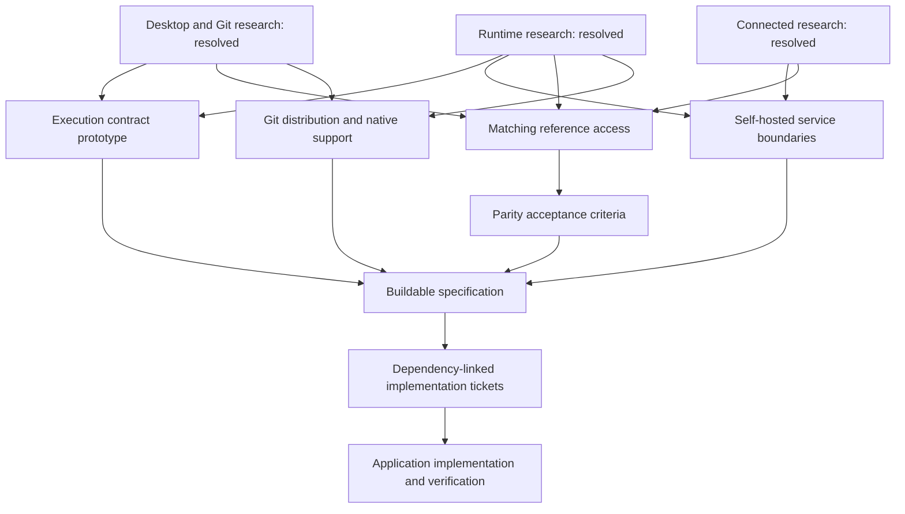

# Project planning status

Snapshot: October 30, 2026 (Asia/Tehran).

## Confirmed direction

Tauri + Rust + React/TypeScript; GitKraken Desktop 12.6.1 parity; Windows validation first, then macOS and Linux; equivalent self-hosted services first; collapsible terminal/activity panel with continuous application-action recording. Future reference releases are tracked separately.

## Completed research

| Investigation | Result |
| --- | --- |
| [Desktop and local Git](research/core-parity.md) | 252 documented checkpoints across 35 official sources |
| [Connected features](research/connected-parity.md) | 133 indexed entries for providers, services, teams, AI and agents |
| [Rust and terminal runtime](research/runtime-architecture.md) | 15 source-backed mechanisms, local readiness evidence and prototype questions |

Counts describe research records, with overlapping entry points between audits. They do not measure implemented features or prove exhaustive observed discovery. Application features remain unimplemented; there is no runnable application yet. No native build or application test has run.

## Decision frontier

The [canonical map](../.scratch/gitkraken-parity/map.md) and individual ticket files own decision state. This snapshot summarizes their current dependencies:

| Work | State | Prerequisites |
| --- | --- | --- |
| [Define the execution history and repository coordination contract](../.scratch/gitkraken-parity/issues/05-execution-contract.md) | Ready; next in tracker order | Core and runtime research resolved |
| [Define equivalent self-hosted service and provider boundaries](../.scratch/gitkraken-parity/issues/06-service-boundaries.md) | Ready | Connected and runtime research resolved |
| [Establish matching reference access](../.scratch/gitkraken-parity/issues/07-reference-access.md) | Ready | All initial research resolved |
| [Define Git distribution and native platform support](../.scratch/gitkraken-parity/issues/08-native-support.md) | Ready | Core and runtime research resolved |
| [Define complete parity acceptance](../.scratch/gitkraken-parity/issues/04-parity-acceptance.md) | Blocked | Matching reference access remains open |

## Material evidence gaps

- The installed GitKraken reports 9.13.0; matching 12.6.1 observation remains necessary.
- Live documentation contains shortcut, theme and historical review-flow inconsistencies. Release notes resolve some, but exact visual and interaction states still need reference observation.
- Rust/Cargo were unavailable on PATH and in the standard locations inspected. MSVC tooling, a Windows SDK and WebView2 are present, but native compatibility is unbuilt.
- Shared cloud workflows need equivalent services beyond the reference product's reduced on-premise feature set.
- Application-generated commands can be recorded exactly through a controlled runner. PTY output alone does not identify every interactive shell command.

## Next work

The user approved complete-workflow testing and the breakdown on October 30, 2026. The [published implementation tracker](../.scratch/git-k-implementation/README.md) contains 125 feature/delivery slices and one final verification gate. Nine envelopes remain pending decisions and decomposition. The [approved breakdown](implementation-draft/breakdown.md) preserves the plan; open map decisions remain open and continue to block dependent production work.

Work the execution-contract prototype with real temporary repositories and the user's review. Preserve truth about command arguments/output, application versus shell origin, hidden-panel recording, failures, prompts, cancellation and shared-worktree state. The [evidence proposal](parity-evidence-proposal.md) remains an input for the later acceptance decision.

After the map's remaining decisions are resolved, continue through specification, dependency-linked implementation tickets and production implementation. Full parity remains the destination; ordering work does not reduce it.
